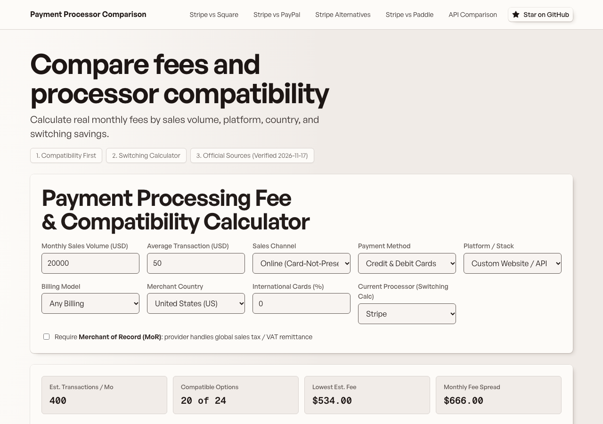

# Payment processor comparison for US businesses

Compare published transaction fees, platform and country compatibility, and monthly switching savings across 24 US payment processors, gateways, ACH APIs, POS systems, and Merchant of Record platforms.

* Interactive calculator and 36 comparison pages: [fintech-infrastructure.github.io/payment-processing-comparison](https://fintech-infrastructure.github.io/payment-processing-comparison/)
* Verified pricing and capability data: [`data/providers.json`](data/providers.json), [`data/pricing.json`](data/pricing.json)
* Last verified: `2026-11-17` from each provider's published pricing page



## Why compatibility comes first

A low headline rate means nothing if the processor rejects your business category, lacks your shopping cart integration, or leaves you registering for sales tax in dozens of jurisdictions. Before ranking fees, the calculator checks five constraints:

1. Merchant country vs. customer country. Stripe accepts buyers in 195+ countries and 135+ currencies, yet only businesses registered in ~46 countries can open a Stripe merchant account. Helcim, Dharma, Stax, and Payment Depot require US (or US and Canadian) entities.
2. Platform lock-in. Adding a third-party gateway to Shopify triggers an extra 0.6% to 2.0% Shopify transaction fee. Shopify Payments, in turn, does not work on WooCommerce or custom SaaS apps.
3. Payment method support. GoCardless and Dwolla process bank-to-bank ACH transfers only and cannot accept cards. Standard PayPal Checkout does not include standalone US ACH bank debit.
4. Tax responsibility. Standard processors leave sales tax and VAT registration to the merchant. Merchant of Record platforms (Paddle, Lemon Squeezy, 2Checkout, FastSpring) act as the seller of record and remit global VAT and sales tax.
5. Underwriting. Flat-rate aggregators (Stripe, Square, PayPal) approve accounts instantly and freeze restricted verticals after launch. High-risk or regulated categories need dedicated underwriting through providers like Durango Merchant Services, Payline Data, or NMI.

## Master comparison table (24 providers)

### Mainstream processors and gateways

| Provider | Pricing model | US online card rate | US in-person rate | ACH rate | Monthly fee | Merchant countries | Source |
| --- | --- | --- | --- | --- | --- | --- | --- |
| Stripe | Flat-rate | `2.9% + $0.30` | `2.7% + $0.05` | `0.8%` (cap `$5.00`) | `$0` | ~46 | [Pricing](https://stripe.com/pricing) |
| Square | Flat-rate | `3.3% + $0.30` (Free) | `2.6% + $0.15` | `1.0%` (`$1.00` min) | `$0` | 8 | [Pricing](https://squareup.com/us/en/payments/our-fees) |
| PayPal | Flat-rate | `2.89% + $0.29` (Expanded) / `3.49% + $0.49` (Wallet) | `2.29% + $0.09` | N/A | `$0` | 200+ | [Pricing](https://www.paypal.com/us/business/accept-payments/checkout) |
| Braintree | Flat-rate | `2.59% + $0.49` | N/A | `0.75%` (cap `$5.00`) | `$0` | ~45 | [Pricing](https://www.braintreepayments.com/braintree-pricing) |
| Shopify Payments | Flat-rate | `2.9% + $0.30` (Basic) | `2.6% + $0.10` | N/A | `$0` (+Shopify) | 23 | [Pricing](https://www.shopify.com/pricing) |
| Authorize.net | Flat-rate / Gateway | `2.9% + $0.30` | N/A | `0.75%` (eCheck) | `$25` | ~30 | [Pricing](https://www.authorize.net/sign-up/pricing.html) |
| Adyen | Custom (Interchange++) | Custom | Custom | Custom | Custom | ~40 | [Pricing](https://www.adyen.com/pricing) |

### Interchange-plus and membership processors (US and Canada)

| Provider | Pricing model | US online markup | US in-person markup | ACH rate | Monthly fee | Merchant countries | Source |
| --- | --- | --- | --- | --- | --- | --- | --- |
| Helcim | Interchange-plus | `IC + 0.50% + $0.25` | `IC + 0.40% + $0.08` | `0.5% + $0.25` (cap `$6`) | `$0` | US, CA | [Pricing](https://www.helcim.com/pricing/) |
| Dharma Merchant Services | Interchange-plus | `IC + 0.20% + $0.11` | `IC + 0.15% + $0.08` | `0.5% + $0.25` | `$20` | US | [Pricing](https://www.dharmamerchantservices.com/rates/) |
| Payline Data | Interchange-plus | `IC + 0.40% + $0.20` | `IC + 0.20% + $0.10` | `0.5% + $0.25` | `$20` (`$10` POS) | US | [Pricing](https://paylinedata.com/pricing/) |
| Payment Depot | Subscription + IC | `IC + 0% + $0.15` | `IC + 0% + $0.10` | N/A | `$79+` | US | [Pricing](https://paymentdepot.com/pricing/) |
| Stax | Subscription + IC | `IC + 0% + $0.15` | `IC + 0% + $0.08` | Custom / Included | `$99+` | US | [Pricing](https://staxpayments.com/pricing/) |

### Bank-backed, micro-POS, and restaurant POS

| Provider | Pricing model | US online card rate | US in-person rate | Monthly fee | Best for | Source |
| --- | --- | --- | --- | --- | --- | --- |
| Chase Payment Solutions | Flat-rate | `2.9% + $0.25` | `2.6% + $0.10` | `$0` | Same-day Chase Business Checking deposits | [Pricing](https://www.chase.com/business/payments/pricing) |
| SumUp | Flat-rate | `2.9% + $0.15` (invoices) | `2.6% + $0.10` | `$0` | Solo operators and mobile invoices | [Pricing](https://www.sumup.com/en-us/pricing/) |
| Clover | Flat-rate | `3.5% + $0.10` | `2.6% + $0.10` | `$14.95+` | Retail and restaurant POS hardware | [Pricing](https://www.clover.com/pricing) |
| Toast | Flat-rate | `3.09% + $0.15` (starter) | `3.09% + $0.15` (`2.49%` on `$69/mo`) | `$0` / `$69+` | Full-service and quick-service restaurants | [Pricing](https://pos.toasttab.com/pricing) |

### Merchant of Record (SaaS and global tax)

| Provider | Pricing model | Standard rate | Global sales tax / VAT | Merchant countries | Source |
| --- | --- | --- | --- | --- | --- |
| Paddle | Merchant of Record | `5.0% + $0.50` | Handled by Paddle | 200+ | [Pricing](https://www.paddle.com/pricing) |
| Lemon Squeezy | Merchant of Record | `5.0% + $0.50` (`+1.5%` intl/PayPal) | Handled by Lemon Squeezy | 135+ | [Pricing](https://www.lemonsqueezy.com/pricing) |
| 2Checkout (Verifone) | Flat-rate / MoR | `3.5% + $0.35` (2Sell) / `6.0% + $0.60` (2Monetize MoR) | Handled on MoR plans | 180+ | [Pricing](https://www.2checkout.com/pricing/) |
| FastSpring | Custom MoR | Custom quote | Handled by FastSpring | 200+ | [Pricing](https://fastspring.com/pricing/) |

### ACH bank debit and high-risk gateways

| Provider | Category | Published rate | Card support | High-risk support | Source |
| --- | --- | --- | --- | --- | --- |
| GoCardless | Bank Debit / ACH | `1.0% + $0.25` (cap `$4.00`) | No (ACH / Direct Debit only) | No | [Pricing](https://gocardless.com/en-us/pricing/) |
| Dwolla | ACH / RTP API | Custom platform pricing | No (US ACH / Same-Day ACH only) | No | [Pricing](https://www.dwolla.com/pricing/) |
| NMI | Gateway-Only | Custom (via ISO/acquirer) | Yes (200+ acquirers) | Specialized | [Pricing](https://www.nmi.com/pricing/) |
| Durango Merchant Services | High-Risk Broker | Custom quote | Yes | Specialized | [Pricing](https://durangomerchantservices.com/high-risk-merchant-accounts/) |

## Real monthly cost benchmarks

The calculator in [`src/calculator/engine.py`](src/calculator/engine.py) produces these monthly totals for US domestic online card transactions. Interchange-plus estimates (`[est]`) add a US card-not-present baseline of `1.95% + $0.10` on top of each provider's markup.

| Provider | `$5,000/mo` (`$50` avg, 100 tx) | `$20,000/mo` (`$50` avg, 400 tx) | `$100,000/mo` (`$100` avg, 1,000 tx) |
| --- | --- | --- | --- |
| Dharma Merchant Services `[est]` | `$148.50` (2.97%) | `$534.00` (2.67%) | `$2,380.00` (2.38%) |
| Payment Depot `[est]` | `$201.50` (4.03%) | `$569.00` (2.84%) | `$2,279.00` (2.28%) |
| Stax `[est]` | `$221.50` (4.43%) | `$589.00` (2.94%) | `$2,299.00` (2.30%) |
| Payline Data `[est]` | `$167.50` (3.35%) | `$610.00` (3.05%) | `$2,670.00` (2.67%) |
| Helcim `[est]` | `$157.50` (3.15%) | `$630.00` (3.15%) | `$2,800.00` (2.80%) |
| SumUp (invoices) | `$160.00` (3.20%) | `$640.00` (3.20%) | `$3,050.00` (3.05%) |
| Chase Payment Solutions | `$170.00` (3.40%) | `$680.00` (3.40%) | `$3,150.00` (3.15%) |
| PayPal (Expanded Cards) | `$173.50` (3.47%) | `$694.00` (3.47%) | `$3,180.00` (3.18%) |
| Stripe | `$175.00` (3.50%) | `$700.00` (3.50%) | `$3,200.00` (3.20%) |
| Shopify Payments (Basic) | `$175.00` (3.50%) | `$700.00` (3.50%) | `$3,200.00` (3.20%) |
| Braintree | `$178.50` (3.57%) | `$714.00` (3.57%) | `$3,080.00` (3.08%) |
| Authorize.net (All-in-One) | `$200.00` (4.00%) | `$725.00` (3.62%) | `$3,225.00` (3.23%) |
| Clover (Starter) | `$199.95` (4.00%) | `$754.95` (3.77%) | `$3,614.95` (3.61%) |
| Square Free (online) | `$195.00` (3.90%) | `$780.00` (3.90%) | `$3,600.00` (3.60%) |
| 2Checkout (2Sell) | `$210.00` (4.20%) | `$840.00` (4.20%) | `$3,850.00` (3.85%) |
| Paddle / Lemon Squeezy (MoR) | `$300.00` (6.00%) | `$1,200.00` (6.00%) | `$5,500.00` (5.50%) |

Under roughly `$8,000/mo`, membership processors (`Payment Depot` at `$79/mo`, `Stax` at `$99/mo`) cost more than Stripe (`$175/mo` vs `$201.50` to `$221.50/mo` at `$5k/mo`), so Stripe, Helcim, or SumUp make more sense early on. At `$20,000/mo`, moving off Square Free (`$780/mo`) to Stripe saves `$80/mo` (`$960/yr`), and moving to Dharma saves around `$246/mo`. At `$100,000/mo`, membership interchange-plus saves roughly `$900/mo` (`$10,800/yr`) over Stripe's `$3,200/mo`. On larger tickets above `~$61.29`, Braintree (`2.59% + $0.49`) also beats Stripe (`2.9% + $0.30`).

## Choosing by business type

For SaaS products that manage their own sales tax, Stripe covers APIs and metered billing while Braintree bundles PayPal and Venmo. If you sell software globally and want to skip multi-state or international VAT registration, use a Merchant of Record such as Paddle, Lemon Squeezy, FastSpring, or 2Checkout (2Monetize).

US small businesses processing `$10,000` to `$100,000+` per month usually lower their effective card rate with Dharma Merchant Services, Helcim, Payment Depot, or Stax. Shopify stores should stick with Shopify Payments to avoid Shopify's `0.6%` to `2.0%` third-party gateway surcharge, while WooCommerce and custom stores can pair with Stripe, Helcim, Braintree, PayPal, or Authorize.net. Physical retail and restaurants fit Square, Toast, Clover, or SumUp. Recurring B2B invoices belong on ACH via GoCardless (`1% + $0.25`, `$4` cap), Stripe ACH (`0.8%`, `$5` cap), or Dwolla. High-risk merchants declined by aggregators need dedicated underwriting via Durango Merchant Services, NMI, or Payline Data.

## Pricing models explained

Flat-rate plans (`2.9% + $0.30`) charge the same percentage regardless of whether a buyer uses a debit card or a high-reward corporate credit card, which keeps billing predictable below `$10,000/mo`. Interchange-plus plans (`IC + 0.20% + $0.11`) pass through wholesale card-network interchange plus a fixed processor markup. Comparing `0.20%` directly to Stripe's `2.9%` is a common mistake because the underlying interchange (~`1.5%` to `2.4%`) is billed on top. Membership plans (`$79` to `$99/mo + IC + $0.15`) drop the percentage markup to `0%` and typically break even once monthly card volume passes `$10,000` to `$15,000`. Merchant of Record plans (`5.0% + $0.50`) cost more per transaction because the provider becomes the legal reseller, remits global taxes, and manages disputes.

See [`docs/methodology.md`](docs/methodology.md) for the exact calculation formulas.

## Switching and token portability

Stripe, Braintree, Helcim, Authorize.net, and NMI support PCI-compliant card PAN/token exports when migrating to another PCI-compliant processor. By contrast, PayPal Wallet billing agreements and Merchant of Record subscriptions (Paddle, Lemon Squeezy) belong to the platform's merchant entity and cannot be exported as raw card tokens. Using Authorize.net or NMI in gateway-only mode lets you switch underlying merchant acquirers without rewriting your checkout integration.

## Guides and comparisons

### Category and API guides
* [Payment gateway API comparison](docs/integrations/payment-gateway-api-comparison.md) ([HTML](https://fintech-infrastructure.github.io/payment-processing-comparison/payment-gateway-api-comparison.html))
* [ACH payment processors compared](https://fintech-infrastructure.github.io/payment-processing-comparison/ach-payment-processors.html)
* [Cheapest US payment processors](https://fintech-infrastructure.github.io/payment-processing-comparison/cheapest-payment-processors.html)
* [Merchant of Record comparison](https://fintech-infrastructure.github.io/payment-processing-comparison/merchant-of-record-comparison.html)

### Alternatives guides (9)
* [Stripe alternatives](docs/alternatives/stripe-alternatives.md) ([HTML](https://fintech-infrastructure.github.io/payment-processing-comparison/stripe-alternatives.html))
* [Square alternatives](docs/alternatives/square-alternatives.md) ([HTML](https://fintech-infrastructure.github.io/payment-processing-comparison/square-alternatives.html))
* [PayPal alternatives](docs/alternatives/paypal-alternatives.md) ([HTML](https://fintech-infrastructure.github.io/payment-processing-comparison/paypal-alternatives.html))
* [Shopify Payments alternatives](docs/alternatives/shopify-payments-alternatives.md) ([HTML](https://fintech-infrastructure.github.io/payment-processing-comparison/shopify-payments-alternatives.html))
* [Braintree alternatives](docs/alternatives/braintree-alternatives.md) ([HTML](https://fintech-infrastructure.github.io/payment-processing-comparison/braintree-alternatives.html))
* [Authorize.net alternatives](docs/alternatives/authorize-net-alternatives.md) ([HTML](https://fintech-infrastructure.github.io/payment-processing-comparison/authorize-net-alternatives.html))
* [Paddle alternatives](docs/alternatives/paddle-alternatives.md) ([HTML](https://fintech-infrastructure.github.io/payment-processing-comparison/paddle-alternatives.html))
* [Clover alternatives](docs/alternatives/clover-alternatives.md) ([HTML](https://fintech-infrastructure.github.io/payment-processing-comparison/clover-alternatives.html))
* [High-risk payment processors](docs/alternatives/high-risk-payment-processors.md) ([HTML](https://fintech-infrastructure.github.io/payment-processing-comparison/high-risk-payment-processors.html))

### Head-to-head comparisons (22)
* [Stripe vs Square](docs/comparisons/stripe-vs-square.md) ([HTML](https://fintech-infrastructure.github.io/payment-processing-comparison/stripe-vs-square.html))
* [Stripe vs PayPal](docs/comparisons/stripe-vs-paypal.md) ([HTML](https://fintech-infrastructure.github.io/payment-processing-comparison/stripe-vs-paypal.html))
* [Square vs PayPal](docs/comparisons/square-vs-paypal.md) ([HTML](https://fintech-infrastructure.github.io/payment-processing-comparison/square-vs-paypal.html))
* [Stripe vs Helcim](docs/comparisons/stripe-vs-helcim.md) ([HTML](https://fintech-infrastructure.github.io/payment-processing-comparison/stripe-vs-helcim.html))
* [Stripe vs Paddle](docs/comparisons/stripe-vs-paddle.md) ([HTML](https://fintech-infrastructure.github.io/payment-processing-comparison/stripe-vs-paddle.html))
* [Stripe vs Braintree](docs/comparisons/stripe-vs-braintree.md) ([HTML](https://fintech-infrastructure.github.io/payment-processing-comparison/stripe-vs-braintree.html))
* [Stripe vs Adyen](docs/comparisons/stripe-vs-adyen.md) ([HTML](https://fintech-infrastructure.github.io/payment-processing-comparison/stripe-vs-adyen.html))
* [Stripe vs Dharma Merchant Services](docs/comparisons/stripe-vs-dharma-merchant-services.md) ([HTML](https://fintech-infrastructure.github.io/payment-processing-comparison/stripe-vs-dharma-merchant-services.html))
* [Stripe vs Stax](docs/comparisons/stripe-vs-stax.md) ([HTML](https://fintech-infrastructure.github.io/payment-processing-comparison/stripe-vs-stax.html))
* [Stripe vs Authorize.net](docs/comparisons/stripe-vs-authorize-net.md) ([HTML](https://fintech-infrastructure.github.io/payment-processing-comparison/stripe-vs-authorize-net.html))
* [Stripe vs Lemon Squeezy](docs/comparisons/stripe-vs-lemon-squeezy.md) ([HTML](https://fintech-infrastructure.github.io/payment-processing-comparison/stripe-vs-lemon-squeezy.html))
* [Stripe vs 2Checkout](docs/comparisons/stripe-vs-2checkout.md) ([HTML](https://fintech-infrastructure.github.io/payment-processing-comparison/stripe-vs-2checkout.html))
* [Square vs Clover](docs/comparisons/square-vs-clover.md) ([HTML](https://fintech-infrastructure.github.io/payment-processing-comparison/square-vs-clover.html))
* [Square vs Toast](docs/comparisons/square-vs-toast.md) ([HTML](https://fintech-infrastructure.github.io/payment-processing-comparison/square-vs-toast.html))
* [Square vs SumUp](docs/comparisons/square-vs-sumup.md) ([HTML](https://fintech-infrastructure.github.io/payment-processing-comparison/square-vs-sumup.html))
* [Square vs Helcim](docs/comparisons/square-vs-helcim.md) ([HTML](https://fintech-infrastructure.github.io/payment-processing-comparison/square-vs-helcim.html))
* [Helcim vs Stax](docs/comparisons/helcim-vs-stax.md) ([HTML](https://fintech-infrastructure.github.io/payment-processing-comparison/helcim-vs-stax.html))
* [Helcim vs Dharma Merchant Services](docs/comparisons/helcim-vs-dharma-merchant-services.md) ([HTML](https://fintech-infrastructure.github.io/payment-processing-comparison/helcim-vs-dharma-merchant-services.html))
* [Helcim vs Payment Depot](docs/comparisons/helcim-vs-payment-depot.md) ([HTML](https://fintech-infrastructure.github.io/payment-processing-comparison/helcim-vs-payment-depot.html))
* [Paddle vs Lemon Squeezy](docs/comparisons/paddle-vs-lemon-squeezy.md) ([HTML](https://fintech-infrastructure.github.io/payment-processing-comparison/paddle-vs-lemon-squeezy.html))
* [GoCardless vs Dwolla](docs/comparisons/gocardless-vs-dwolla.md) ([HTML](https://fintech-infrastructure.github.io/payment-processing-comparison/gocardless-vs-dwolla.html))
* [Authorize.net vs NMI](docs/comparisons/authorize-net-vs-nmi.md) ([HTML](https://fintech-infrastructure.github.io/payment-processing-comparison/authorize-net-vs-nmi.html))

## CLI and Python usage

Run locally with Python 3.9+ (zero external dependencies):

```bash
# Compare compatible processors and switching savings from Stripe at $20k/mo ($50 avg ticket)
python3 -m src.calculator.cli --volume 20000 --ticket 50 --platform custom_website --current stripe

# Filter for SaaS Merchant of Record platforms
python3 -m src.calculator.cli --volume 15000 --ticket 49 --platform saas_billing --billing subscriptions --mor

# Compare ACH bank-to-bank processors
python3 -m src.calculator.cli --volume 50000 --ticket 500 --payment-type ach
```

Run the schema and calculation test suite:

```bash
python3 -m unittest discover -s tests -v
```

Regenerate all HTML and Markdown pages after editing `data/*.json`:

```bash
cp data/*.json docs/data/
python3 scripts/generate_pages.py
```

## Contributing and data verification

Pull requests to update published pricing, add regional processors, or refine compatibility rules are welcome. Every PR must include an official `source_url` and `verification_date` in [`data/pricing.json`](data/pricing.json) and [`data/providers.json`](data/providers.json), sync `docs/data/`, and pass `.github/workflows/ci.yml`. Custom enterprise processors without public flat or markup rates stay marked as `Custom pricing` rather than guessed.

Licensed under the [MIT License](LICENSE).
